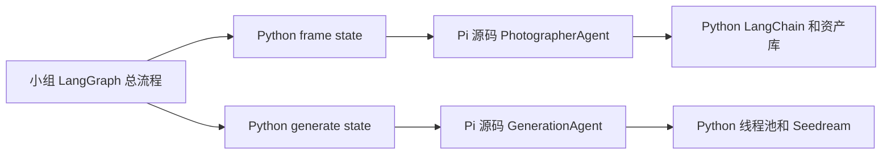

# 小囍 · Pi 源码改造版

本目录由 Pi 官方仓库 v1.2.0 的源码裁剪、修改而来，直接运行本地 TypeScript 源码。
摄影师和生图两个 Agent 位于 `packages/wedding/src/`，继承本地改过的 Pi `Agent`。
运行时不安装或加载 `@earendil-works/pi-agent-core`、`@earendil-works/pi-ai` npm 包。

原始仓库：https://github.com/earendil-works/pi
固定提交：`06a466935536f8c9bcacb2d5efc0fc021be1bdff`（v1.2.0）。
MIT 许可证及原作者信息保留在 `LICENSE`；完整原始下载位于交付目录的 `pi-upstream/`，
该目录仅用于对比，不是运行依赖，也不必复制给框架同学。

## 源码改了什么

保留 Pi 的会话状态、Agent 循环、工具校验、事件流以及顺序/并行执行机制。
修改 `packages/agent/src/agent.ts`、`agent-loop.ts` 和 `types.ts`，加入：

- 摄影师只能注册 `search_assets`，生图只能注册 `generate_candidate`。
- 工具集合替换时检查角色；每轮执行前再次检查，工具数组的外部增删不影响内部注册。
- 工具调用次数和模型轮次分别设上限，在额外工具执行前终止。
- 必须显式提供 Python 模型适配器，取消默认全局模型和网络代理出口。

`packages/ai/src/` 只保留 Pi 的消息/工具协议、事件流、上下文和参数校验。
已移除 Pi 原有的编程 Agent 工具 `bash`、`powershell`、`read`、`write`、`edit`、
`grep`、`find`、`ls`，以及编程 CLI、TUI、扩展加载、OAuth、云模型适配器及其他无关模块。
逐文件移除清单及来源在 `UPSTREAM.json`，可重放的修改在交付目录的 `pi-source.patch`。
本项目是针对婚纱照任务的裁剪版，不提供原 Pi 编程助手的全部功能。

## 两个 Agent

| Agent | Pi 源码实现 | 业务工具 |
|---|---|---|
| 摄影师 | `packages/wedding/src/photographer.ts` | 检索姿态和背景素材，基于模型决策循环，输出 shot |
| 生图 | `packages/wedding/src/generation.ts` | 并行执行已确认的候选计划，调用 Python 生图工具 |

摄影师的大语言模型仍由小组 Python 的 LangChain `get_llm("agent")` 和结构化输出调用。
生图采用固定计划，Pi 负责并行工具执行，不额外调用语言模型。
Seedream API、重试、备用服务、图片读写及业务参数校验都保留在 Python 生图模块。
用户照片和密钥不发送给 Node；工具的结果和决策通过本地 stdin/stdout 的 JSON 消息交换。
一次 Python 调用创建一个独立 Pi 进程；超时由 Python 终止进程。



## 安装和运行

目录必须保持相邻，Python 入口按相对位置加载本地 Pi 源码：

```text
项目根目录/
  pi-wedding/           ← 本目录
  wedding-agent/        ← 小组 Python 后端
```

使用 Python 3.11 和 Node.js 22.19+，并让 `node` 在 PATH 中。
Node 直接执行可擦除类型的 TypeScript，不需要额外编译步骤。

```bash
cd pi-wedding
npm ci --ignore-scripts
npm run check
npm run test:unit
cd ../wedding-agent
uv sync --frozen
uv run pytest tests/test_contracts.py
uv run pytest
```

部署时可以用 `npm ci --omit=dev --ignore-scripts` 只安装运行依赖。
运行依赖只有 `typebox@1.3.27`；检查依赖为 TypeScript、Biome 和 Node 类型，版本全部锁定。
小组 Python 接口保持 `frame(state) -> dict`、`generate(state) -> dict`；
`app/graph.py`、工单、契约、runner 和公共配置保持原有内容。

fake 模式保留原小组行为，不启动 Pi，不调用付费服务。
真实模式按两个 Python 模块 README 配置既有环境变量。
摄影师正式模型、三档正式姿态资产、付费真人出图质量和真实备用 workflow 仍需联调。
