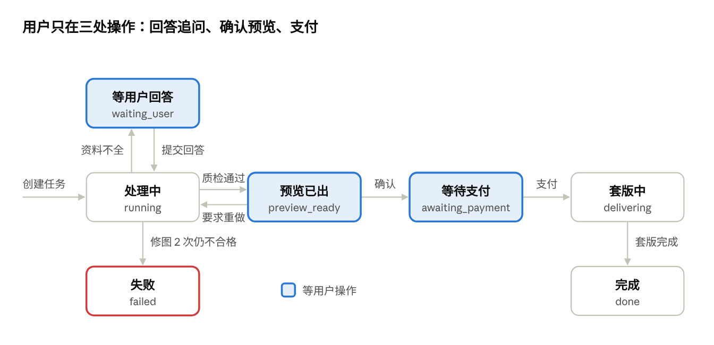

# 小囍接口约定

更新于 2026-10-13 · [在线版](https://claude.ai/artifact/V5PJCVxsVLuCUiWn72zGDg)

前后端用 6 个接口对接：框架负责实现，前端负责调用，字段以本文为准；有改动先改这份文档，再改代码。后端启动后，接口说明页在 http://127.0.0.1:8000/docs 。

## 通用约定

- 地址前缀统一为 `/api`。除上传文件外，请求和返回都用 JSON。
- 字段名用英文小写加下划线，比如 `task_id`。状态、步骤等取值也用英文，由前端翻译成中文显示；`step_text` 和 `message` 由后端直接给中文。
- 图片一律返回地址（URL），由资产库生成。带水印的预览图和高清图是两个不同的地址。
- 任务开始后，前端每 1.5 秒查询一次状态；连续 3 分钟没有新进展，提示用户稍后再试。
- 出错时返回 HTTP 4xx 或 5xx，正文统一为 `{"error": {"code": "PHOTO_INVALID", "message": "照片里只检测到 1 个人"}}`，`message` 可以直接显示给用户。
- 前端不用等后端：先按本文的示例 JSON 用假数据把页面做出来，接口好了再切换。

## 接口一览

| # | 方法 | 路径 | 用途 | 前端什么时候调用 |
| --- | --- | --- | --- | --- |
| 1 | POST | `/api/uploads` | 上传一张图片，返回文件编号 | 用户选好照片时；补传照片时 |
| 2 | POST | `/api/tasks` | 用照片和描述创建任务，流程开始 | 用户点“开始” |
| 3 | GET | `/api/tasks/{task_id}` | 查状态、进度、追问、预览和成品 | 任务开始后每 1.5 秒一次 |
| 4 | POST | `/api/tasks/{task_id}/answers` | 提交追问的回答 | 状态为 `waiting_user` 时 |
| 5 | POST | `/api/tasks/{task_id}/review` | 确认一张预览，或要求重做 | 状态为 `preview_ready` 时 |
| 6 | POST | `/api/tasks/{task_id}/pay` | 模拟支付，解锁高清图和物料 | 状态为 `awaiting_payment` 时 |

## 任务状态



前端只根据 `status` 切换页面：带色的三种状态在等用户操作，其余时间显示进度。

`step` 的取值，前端用它播放专家接力动画：

| `step` | 显示 | 负责的块 |
| --- | --- | --- |
| `intake` | 小囍接单，和用户确认照片、授权、身高、物料 | 主 agent |
| `styling` | 妆造师设计造型，和用户确认风格、妆容、衣服（两人共用一套） | 妆造师 |
| `framing` | 摄影师设计镜头，和用户确认场景（灯光、季节、互动按风格和场景自动带出） | 摄影师 |
| `composing` | 小囍写拍摄指令 | 主 agent |
| `generating` | 生图中 | 生图 agent |
| `checking` | 质检打分 | 评测修图师 |
| `retouching` | 修图师修图 | 评测修图师 |
| `packaging` | 套版制作物料、小囍写寄语 | 资产库、主 agent |

## 接口详情

### 1. 上传图片 `POST /api/uploads`

请求用 `multipart/form-data`，字段名 `file`，只收 jpg 和 png，单张不超过 10 MB。返回：

```json
{"file_id": "f_8a1c", "url": "https://cdn.example.com/files/f_8a1c.jpg"}
```

### 2. 创建任务 `POST /api/tasks`

```json
{"photo_file_ids": ["f_8a1c"], "description": "想要韩式影棚风，婚礼在 12 月"}
```

`photo_file_ids` 是主入口：页面只有一个上传框，合照、单人照混在一起传，共 1～10 张，由小囍（看照片 skill）分出新郎和新娘，分好后写进 `plan.photos` 的 `groom`、`bride`。旧的分开上传写法 `groom_photo_file_ids`、`bride_photo_file_ids`（两组各 1～10 张）保留兼容，新页面不再使用。`description` 可以为空。返回：

```json
{"task_id": "t_8f3a2c", "status": "running"}
```

### 3. 查询任务 `GET /api/tasks/{task_id}`

返回的字段始终齐全，没有值时为 `null` 或空数组。

| 字段 | 什么时候有值 | 说明 |
| --- | --- | --- |
| `status` | 一直有 | 任务状态，见“任务状态” |
| `step` | `running`、`delivering`、`waiting_user` 时 | 当前步骤；等用户回答时表示是谁在问：`intake` 小囍、`styling` 妆造师、`framing` 摄影师 |
| `step_text` | 同上 | 进度文案；等用户回答时是提问的那位说的话，前端显示在对话气泡里 |
| `questions` | `waiting_user` 时 | 当前这位的提问，每轮最多 4 个；小囍、妆造师、摄影师各最多 2 轮 |
| `previews` | `preview_ready` 时 | 样片阶段 1 张；套图阶段 9 张带水印候选图 |
| `generation` | 生图完成后 | `stage` 为 `sample` 或 `set`，以及累计生成数量 |
| `deliverables` | `done` 时 | 高清图和婚礼物料 |
| `message` | `done` 时 | 小囍的揭幕寄语 |
| `error` | `failed` 时 | 失败原因，格式同“通用约定” |
| `plan` | 一直有，内容随流程逐步填上 | 只读的方案进度，给前端画布显示：`photos`（`groom`、`bride`、`all` 三组照片地址）、`brief`（`heights_cm`、`materials`、`invitation`、`keep_features`、`beautify`，小囍整理前为 `null`）、`look`（妆造师方案，`text`、`style`、`references`）、`shot`（摄影师方案，`text`、`pose`、`references`）、`shots`（9 个镜头，每项 `slot`、`framing` 景别、`scene`、`text`）。还没到的部分为 `null` 或空数组 |

`plan` 示例（摄影师给出方案之后）：

```json
"plan": {
  "photos": {"groom": ["https://cdn.example.com/u/g1.jpg"], "bride": ["https://cdn.example.com/u/b1.jpg"], "all": ["...g1", "...b1"]},
  "brief": {"heights_cm": [180, 165], "materials": ["invitation", "welcome_poster", "led_screen"], "invitation": {"names": "张三 & 李四"}, "keep_features": [], "beautify": "none"},
  "look": {"text": "新娘：清透原生妆……；新郎：自然控油修饰……", "style": "chinese_red_gold", "references": [{"url": "https://cdn.example.com/a/look_1.jpg", "role": "outfit"}]},
  "shot": {"text": "晴日庄园草坪，柔和自然光……", "pose": "keep_original", "references": []},
  "shots": [{"slot": 0, "framing": "全身", "scene": "晴日庄园草坪", "text": "全身构图，两人并肩看镜头"}]
}
```

等用户回答时的返回示例：

```json
{
  "task_id": "t_8f3a2c",
  "status": "waiting_user",
  "step": "styling",
  "step_text": "妆造师想先确认风格",
  "questions": [
    {
      "question_id": "q_style",
      "type": "single_choice",
      "title": "想要哪种风格？",
      "options": [
        {"value": "korean_studio", "label": "韩式影棚", "image": "https://cdn.example.com/styles/korean.jpg"},
        {"value": "keep_original", "label": "保留原图场景", "image": "https://cdn.example.com/styles/original.jpg"}
      ],
      "recommended": "korean_studio",
      "allow_skip": true
    },
    {
      "question_id": "q_height",
      "type": "text",
      "title": "两人身高大概多少？",
      "placeholder": "例如 175 / 162",
      "allow_skip": true
    }
  ],
  "previews": [],
  "deliverables": null,
  "message": null,
  "error": null
}
```

`type` 有四种：`single_choice` 单选、`multi_choice` 多选、`text` 填空、`upload` 补传照片（回答时 `value` 填上传得到的 `file_id`，一张填字符串、多张填数组；后端把它们换成图片地址，附在这条回答的 `urls` 里交给提问的 agent，编号不存在时返回 `FILE_INVALID`）。用户跳过时，后端用 `recommended` 或默认值。

预览出来后，`previews` 是这样：

```json
"previews": [
  {"image_id": "img_1", "url": "https://cdn.example.com/p/img_1_wm.jpg", "is_best": true}
],
"generation": {"stage": "sample", "total_images": 1}
```

完成后，`deliverables` 是这样（`moments` 是从主视觉裁出来的朋友圈图）：

```json
"deliverables": {
  "photo": "https://cdn.example.com/d/photo_hd.jpg",
  "photos": ["https://cdn.example.com/d/photo_01_hd.jpg", "... 共 9 张"],
  "invitation": "https://cdn.example.com/d/invitation_4x5.jpg",
  "welcome_poster": "https://cdn.example.com/d/poster_2x3.jpg",
  "led_screen": "https://cdn.example.com/d/led_16x9.jpg",
  "moments": "https://cdn.example.com/d/moments.jpg"
}
```

### 4. 提交回答 `POST /api/tasks/{task_id}/answers`

```json
{
  "answers": [
    {"question_id": "q_style", "value": "korean_studio"},
    {"question_id": "q_height", "skipped": true}
  ]
}
```

多选题的 `value` 是数组。返回 `{"status": "running"}`，流程继续。

### 5. 确认或重做 `POST /api/tasks/{task_id}/review`

确认：

```json
{"action": "confirm", "image_id": "img_1"}
```

只要这一张（只在样片阶段可用）：

```json
{"action": "sample_only", "image_id": "img_1"}
```

重做：

```json
{"action": "redo", "image_id": "img_2", "reason": "face", "note": "男生不太像"}
```

`reason` 取值：`face` 脸不像、`body` 身材比例不对、`hands` 手部有问题、`style` 不喜欢风格、`other` 其他。每个任务最多重做 2 次。样片阶段确认后返回 `{"status": "running"}`，继续生成 9 张套图；套图阶段确认后返回 `{"status": "awaiting_payment"}`，重做后返回 `{"status": "running"}`。`sample_only` 跳过 9 张套图，直接用这张样片进入支付和交付（高清图 + 婚礼物料），返回 `{"status": "awaiting_payment"}`；交付里只有 `photo` 和各物料，没有 `photos` 列表。套图阶段传 `sample_only` 返回 `WRONG_STATUS`。前端可用查询接口里的 `generation.stage`（`sample` / `set`）决定是否显示「只要这一张」。

### 6. 模拟支付 `POST /api/tasks/{task_id}/pay`

```json
{"method": "mock"}
```

返回 `{"status": "delivering"}`，资产库开始套版，完成后状态变为 `done`。以后接真实支付，只换后端实现，接口不变。

### 错误码

| code | 什么时候 | 前端怎么处理 |
| --- | --- | --- |
| `PHOTO_INVALID` | 照片不合格：人数不对、太模糊、有遮挡 | 显示 `message`，引导重新上传 |
| `FILE_INVALID` | 文件超过 10 MB，或不是 jpg / png | 提示换一张 |
| `TASK_NOT_FOUND` | 任务编号不存在或已过期 | 回到首页 |
| `WRONG_STATUS` | 调用时机不对，比如还没出预览就确认 | 重新查询一次状态 |
| `REDO_LIMIT` | 重做超过 2 次 | 提示联系人工 |
| `GENERATION_FAILED` | 修图 2 次仍不合格，或生图服务出错 | 显示 `message`，提供“重新开始” |
| `LOGIN_REQUIRED` | 没有登录会话或已过期（nginx 返回 401，前台、后台接口都一样） | 刷新页面，nginx 会转到登录页 |
| `ACCESS_DENIED` | 没有邀请码凭证或已作废（401） | 刷新页面，回到邀请码页 |
| `IP_NOT_ALLOWED` | 图墙 / 后台接口：来源 IP 不在团队白名单（403） | 刷新页面（会显示 403） |

所有 401 前端统一刷新页面（`web/src/http.js`），不再依赖接口被重定向到登录页。

## 待定事项

下面几件事还没定，但都不需要改接口：

- 照片输入：新客户端使用 `groom_photo_file_ids`、`bride_photo_file_ids`，双方各 1～10 张；旧客户端仍可使用 `photo_file_ids`。
- 小囍用固定表单还是对话追问：两种都通过 `questions` 下发，前端的渲染方式不变。
- 修图师用 agent 还是简单重试：只影响后端，前端只会看到 `step` 变成 `retouching`。
- 风格选项有哪些：由主 agent 和妆造师维护，接口只传 `value` 和 `label`。
- 是否接真实支付：`pay` 接口不变，只换后端实现。

后端各块之间传递的工单字段，见《小囍模块接入规范》。
