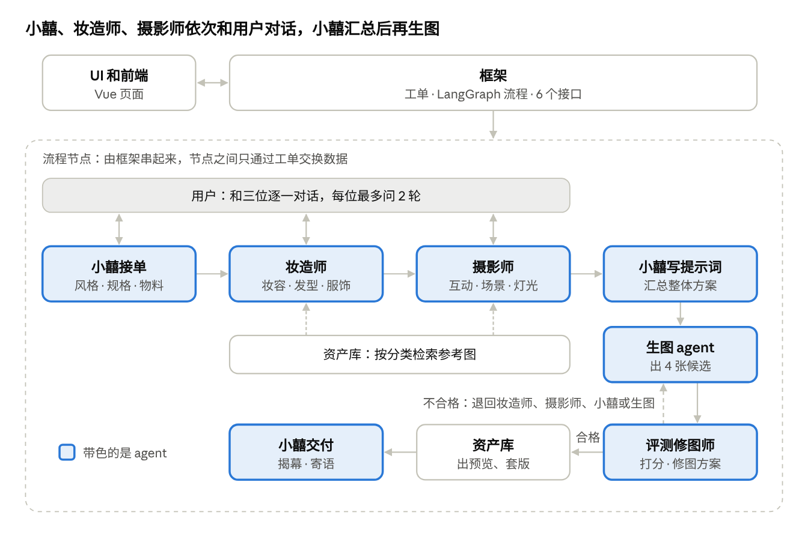

# 小囍模块接入规范

更新于 2026-10-13 · [在线版](https://claude.ai/artifact/ExBnqRBGUrVmqcsNfNXV8T)

项目共 8 个模块。每位组员把「开场白」「工单字段」「通用规范」「命名与替换规则」和自己的「模块卡片」一起发给自己的 AI；开工前先拉取框架骨架，做完按「交付自检」逐条检查，就能直接接入。前后端接口见《小囍接口约定》（`docs/小囍接口约定.md`）。

## 发给 AI 的开场白

把下面这段复制给你的 AI，把【】里的内容换成你自己的，再把后面几节粘贴在它下面。

```text
你在帮我开发「小囍」AI 婚纱照项目里的【模块名】模块。
项目用 Python 3.11 + LangGraph + LangChain，由框架同学把 8 个模块串成一条流程。
代码仓库里已经有框架骨架：app/state.py（工单定义）和 app/common/（公共工具）。

请严格遵守下面的「工单字段」「通用规范」「命名与替换规则」和我的「模块卡片」：
1. 只在 【模块文件夹，如 app/modules/styling/】 里写代码。
2. 函数名、参数、返回的字段，必须和模块卡片完全一致。
3. 不要修改工单定义、公共工具或别人的模块；觉得需要改，先停下来问我。
4. 不确定的地方先问我，不要自己发明字段或接口。
做完后，按「交付自检」逐条检查，告诉我每一条的结果。

【粘贴：工单字段】
【粘贴：通用规范】
【粘贴：命名与替换规则】
【粘贴：你的模块卡片】
【粘贴：交付自检】
```

## 整体流程



小囍、妆造师、摄影师依次和用户对话：小囍以项目经理身份确认照片、授权、身高、物料和请柬信息；妆造师从资产库找参考图，只和用户确认风格、妆容、衣服三件事（两人共用一套），发型和配饰由妆造师按风格搭配；摄影师只和用户确认场景，灯光、季节、互动按风格和场景自动带出。三人都确认完，小囍汇总写成最终提示词，再交给生图。质检不合格时，修图方案会指明退回哪一块：脸不像或手部有问题退回生图，身材比例不对退回摄影师，风格不对退回妆造师，提示词没写清楚退回小囍；修图阶段不再问用户。

## 项目结构

每个模块一个文件夹，各改各的。框架骨架已经建好所有文件夹和占位实现。

```text
wedding-agent/
├── app/
│   ├── state.py          工单定义（框架维护，其他人只读）
│   ├── graph.py          LangGraph 流程（框架维护）
│   ├── api.py            前后端接口（框架维护）
│   ├── runner.py         后台跑流程、暂停等用户、继续（框架维护）
│   ├── contracts.py      模块接口契约，检查模块返回值（框架维护）
│   ├── common/           公共工具：配置、大模型、错误、日志（框架维护）
│   └── modules/
│       ├── intake/       主 agent：小囍
│       ├── styling/      妆造师
│       ├── framing/      摄影师
│       ├── generation/   生图 agent
│       ├── review/       评测修图师
│       └── assets/       资产库
├── web/                  前端（UI 和前端）
├── tests/
│   ├── fixtures/         示例工单 JSON（框架提供）
│   └── photos/           测试照片（评测修图师维护，不提交到仓库）
├── docs/                 本规范和接口约定
├── .env.example          需要哪些密钥和配置（只写名字，不写值）
└── pyproject.toml
```

每个模块文件夹内部统一这样放：

```text
app/modules/styling/
├── __init__.py          只导出模块卡片里规定的函数
├── node.py              主要逻辑
├── prompts/             提示词文件（.md），不写死在代码里
└── test_styling.py      本模块的测试
```

框架提供的公共工具，所有模块都用它们，不要自己另写一套：

| 写法 | 用途 |
| --- | --- |
| `from app.state import WeddingState, Brief` | 工单和需求单的类型 |
| `from app.common.config import settings` | 读密钥和参数：阈值、张数上限、超时、是否 fake 模式 |
| `from app.common.llm import get_llm` | 取大模型：`get_llm("agent")`、`get_llm("cheap")`、`get_llm("vision")` |
| `from app.common.errors import ModuleError` | 报错：`raise ModuleError("PHOTO_INVALID", "照片里只检测到 1 个人")` |
| `from app.common.log import get_logger` | 打日志，自动带上任务编号 |
| `from app.modules.assets import save_image, load_image, search_assets` | 存图拿地址、按地址读图、找物料（唯一允许跨模块调用的地方） |

## 工单字段

工单是所有模块共用的一张表：每个模块只读自己需要的字段，只写「谁写」一栏里是自己的字段。要新增或改字段，先改这张表，再由框架同学改 `state.py`。

| 字段 | 类型 | 谁写 | 谁读 | 说明 |
| --- | --- | --- | --- | --- |
| `task_id` | str | 框架 | 全部 | 任务编号 |
| `photo_urls` | list[str] | 框架建单；小囍补传照片后可更新 | 小囍、生图、评测 | 全部照片地址。分组任务必须等于 `groom_photo_urls` + `bride_photo_urls`（按这个顺序） |
| `groom_photo_urls`、`bride_photo_urls` | list[str] | 框架建单；小囍补传照片后可更新 | 小囍、生图、评测 | 分组任务的新郎、新娘照片，每组 1～10 张；旧的合照任务没有这两个字段 |
| `consent` | dict | 框架建单（接口传入时）；小囍 | 小囍 | 照片授权记录，不拼进提示词 |
| `description` | str | 框架 | 小囍 | 用户的一句话描述 |
| `answers` | list[dict] | 框架 | 小囍、妆造师、摄影师 | 用户的回答，每条记着是谁问的（asker）和第几轮；补传照片题（`type: "upload"`）的回答另带 `urls`，是框架把上传编号换成的图片地址 |
| `question_rounds` | dict | 框架 | 框架 | 每位 agent 已经问了几轮 |
| `questions` | list[dict] | 小囍、妆造师、摄影师 | 框架 | 要追问的问题，格式见《小囍接口约定》 |
| `brief` | dict（字段见 Brief） | 小囍 | 妆造师、摄影师、小囍、评测、资产库 | 需求单，字段见下表 |
| `look` | dict | 妆造师 | 摄影师、小囍 | 造型描述和挑好的参考图 |
| `shot` | dict | 摄影师 | 小囍 | 镜头描述和挑好的参考图 |
| `shots` | list[dict] | 摄影师（可选） | 小囍 | 分镜表：每张套图一个镜头，slot 0 同时用于样片 |
| `prompt` | str | 小囍 | 生图、评测 | 汇总 look 和 shot 后写的最终提示词（各镜头共用部分） |
| `shot_prompts` | list[dict] | 小囍（可选） | 生图 | 每个镜头的最终提示词；生图按 slot 取，没有时用 `prompt` |
| `sample_only` | bool | 框架 | 框架 | 用户在样片页选了「只要这一张」，跳过套图直接交付 |
| `references` | list[dict] | 小囍 | 生图 | 生图时带上的参考图 |
| `candidates` | list[dict] | 生图 | 评测、资产库 | 候选图 |
| `generation` | dict | 生图 | 框架 | 用了哪个服务、哪条工作流、耗时、张数 |
| `scores` | list[dict] | 评测 | 框架 | 每张图的分数和问题 |
| `best_image_id` | str | 评测 | 资产库 | 最好的一张 |
| `passed` | bool | 评测 | 框架 | 是否通过质检 |
| `retouch_plan` | dict | 评测 | 妆造师、摄影师、小囍、生图 | 修图方案：退回哪一块、怎么改 |
| `retry_count` | int | 框架 | 评测 | 已修图次数 |
| `user_feedback` | dict | 框架 | 评测 | 用户要求重做时的原因 |
| `previews` | list[dict] | 资产库 | 框架 | 带水印的预览图 |
| `deliverables` | dict | 资产库 | 框架、小囍 | 高清图和物料 |
| `message` | str | 小囍 | 框架 | 揭幕寄语 |

进度信息 `status`、`step`、`error` 由框架管理，不在工单里。任何模块都可以在返回值里带 `step_text`（给用户看的进度文案），框架转给前端。

需求单 `brief` 的字段。小囍只填 `intent`、`heights_cm`、`body_types`、`keep_features`、`beautify`、`materials`、`invitation`、`missing` 这 8 个；`style`、`background`、`makeup`、`outfit_bride`、`outfit_groom`、`expression`、`pose` 这 7 个造型／镜头字段暂时保留（修图师还在读），默认值是 `"undecided"`（还没定），小囍不再填写，妆造师和摄影师也不要读，需要用户原话时读工单的 `description`。修图师改完后框架会删掉这 7 个字段。

| 字段 | 类型 | 例子 |
| --- | --- | --- |
| `intent` | str | `"photo_and_materials"` |
| `style` | str | 暂留，默认 `"undecided"` |
| `background` | str | 暂留，默认 `"undecided"` |
| `makeup` | str | 暂留，默认 `"undecided"` |
| `outfit_bride` | str | 暂留，默认 `"undecided"` |
| `outfit_groom` | str | 暂留，默认 `"undecided"` |
| `expression` | str | 暂留，默认 `"undecided"` |
| `pose` | str | 暂留，默认 `"undecided"` |
| `heights_cm` | list[int] | `[175, 162]` |
| `body_types` | list[str] | `["标准", "偏瘦"]` |
| `keep_features` | list[str] | `["女生的眼镜", "男生右眉的痣"]` |
| `beautify` | str | `"none"`（默认）或 `"light"`，只有用户主动选才能是 light |
| `materials` | list[str] | `["invitation", "welcome_poster", "led_screen"]` |
| `invitation` | dict | `{"names": "小林 & 小周", "date": "2026-12-20", "place": "XX 酒店"}` |
| `missing` | list[str] | 还缺的字段；空列表表示资料齐了 |

## 通用规范

所有后端模块都要遵守这 13 条，前端只看第 1、5、13 条。

1. 只改自己模块的文件夹。需要改工单、公共工具或别人的模块，先找框架同学。
2. 模块之间不直接互相调用，只通过工单交换数据。唯一例外是调用资产库的 `save_image`、`load_image` 和 `search_assets`。
3. 节点函数写法固定：`def 函数名(state: WeddingState) -> dict`。只返回模块卡片里允许写的字段，不要修改传进来的 `state`。必须是普通函数（`def`），不能是 `async def`：流程是同步运行的，async 函数接不上。
4. 大模型统一用 `get_llm(...)` 获取，代码里不写模型名和密钥。要结构化结果时用 LangChain 的 `with_structured_output`，不要自己解析文本。
5. 密钥和可调参数（阈值、张数上限、超时）都从 `settings` 读。新增的配置项写进 `.env.example`，只写名字不写值；`.env` 不提交到仓库。
6. 提示词放在模块的 `prompts/` 文件夹，用 .md 文件，方便产品同学直接改。
7. 必须支持 fake 模式：`settings.fake_for("模块名")` 为真时，不调用任何付费服务，返回固定的示例数据。全流程联调先用 fake 模式跑；要让某个模块走真实实现，在 `.env` 的 `REAL_MODULES` 里写上它的名字。
8. 出错时抛 `ModuleError(code, message)`：code 用《小囍接口约定》里的错误码，message 写给用户看的中文。不要吞掉异常。
9. 每个付费调用都要有超时和次数上限，上限从 `settings` 读，不要无限重试。agent 模块（小囍、妆造师、摄影师、生图、评测修图师）的循环也要有最多几步的上限。
10. 用户照片只通过资产库存放，不写到别的地方，不打印到日志，不上传到项目以外的服务。
11. 每个模块自带测试 `test_<模块名>.py`，用 `tests/fixtures/` 里的示例工单，能用 `uv run pytest app/modules/<模块名>` 跑通。
12. 新增依赖用 `uv add`，并在提交说明里写清楚。Python 3.11，函数加类型标注，文件名用英文，注释可以用中文。
13. 用 Git 分支开发，每个模块一个分支；合并前给框架同学看一眼。

## 命名与替换规则

替换实现时只换函数内部，下面这些名字和格式都不能改，改了框架就接不上。做完运行 `uv run pytest tests/test_contracts.py`，全部通过就说明能直接替换；流程运行时也会自动做同样的检查。

### 不能改的名字

| 对象 | 规则 | 例子 |
| --- | --- | --- |
| 模块文件夹 | 固定 6 个，不改名、不新增 | `app/modules/styling/` |
| 对外函数 | 按模块卡片命名，从模块的 `__init__.py` 导出；文件夹内部怎么拆文件随意 | `from app.modules.styling import style` |
| 工单字段 | 只用「工单字段」表里的名字 | `look`、`shot` |
| 输出里的键 | 按下面的「输出格式」，不增不减 | `look` 只有 `text`、`style` |
| 错误码 | 只用《小囍接口约定》里的 6 个 | `PHOTO_INVALID` |
| 生图服务入口 | `generation/client.py` 的 `generate_image(photo_urls, prompt, seed, references)`，返回 jpg 或 png 图片内容 | — |
| 前端页面组件 | 6 个组件的输入和事件名不变，见本节最后一张表 | `PreviewStep` 触发 `review` |

### 自己起名的规则

| 对象 | 规则 | 例子 |
| --- | --- | --- |
| 文件、函数、变量 | 英文小写加下划线 | `face_compare.py`、`load_template` |
| 类 | 每个单词首字母大写 | `FaceScorer` |
| 常量 | 全大写加下划线 | `MAX_SIDE` |
| 风格编号 | 英文小写加下划线。同一个编号同时用在需求单 `style`、追问选项 `value`、妆造师模板 `prompts/<编号>.md`、资产库物料的标签 | `korean_studio` |
| 物料编号 | `<种类>_<名字>`，种类是 `style`、`outfit`、`makeup`、`pose`、`background`、`layout`；登记在资产库 `templates/catalog.json` | `outfit_korean_satin` |
| 风格物料 | 种类 `style`，编号 `style_<风格编号>`；去掉 `style_` 前缀就是风格编号 | `style_korean_studio` |
| 衣服物料（一套婚纱 + 西装） | 种类 `outfit`；`tags` 里带风格编号；图片是新娘和新郎同框；`description` 写明婚纱和西装 | `outfit_korean_studio_satin` |
| 姿势编号 | `<身高档>_<字母>`，身高档是 `close`、`medium`、`large`；对应的物料编号是 `pose_<姿势编号>` | `medium_a` |
| 参考图用途 | `role` 只能是 `style`、`outfit`、`makeup`、`pose`、`background` | `pose` |
| 物料版式 | `templates/layouts/<物料名>.png`，物料名用 `deliverables` 的键 | `invitation.png` |
| 追问编号 | `q_` 加对应的需求单字段 | `q_style`、`q_height` |
| 配置项 | 全大写加下划线，带服务前缀；找框架同学加进 `settings` 和 `.env.example` | `FACE_API_KEY` |
| 日志 | `get_logger("<模块文件夹名>")` | `get_logger("review")` |
| 前端组件 | 每个单词首字母大写，页面组件以 `Step` 结尾 | `PreviewStep.vue` |
| Git 分支 | `module/<模块文件夹名>` | `module/styling` |
| 提交说明 | `[<模块文件夹名>] 做了什么` | `[styling] 新增中式风格模板` |

### 输出格式

| 字段 | 格式 |
| --- | --- |
| `look` | `{"text": str, "style": str, "references": [参考图]}` |
| `shot` | `{"text": str, "pose": str, "references": [参考图]}` |
| `shots` | 列表，每项 `{"slot": int≥0, "pose": str, "framing": 景别, "scene": str, "text": str}`，slot 不能重复 |
| `prompt` | str |
| `shot_prompts` | 列表，每项 `{"slot": int≥0, "prompt": 非空 str}`，slot 不能重复 |
| `references` | 列表，每项是一张参考图 `{"url": str, "role": str}`，最多 `settings.max_reference_images` 张 |
| `candidates` | 列表，每项 `{"image_id": str, "url": str, "seed": int}` |
| `generation` | `{"engine": str, "workflow": str, "seconds": float, "total_images": int}` |
| `scores` | 列表，每项 `{"image_id": str, "face_sim": [float, float], "body_ok": bool, "hands_ok": bool, "issues": [str], "total": float}` |
| `retouch_plan` | `{"target": "look" 或 "shot" 或 "prompt" 或 "generate" 或 "none", "patch": str, "image_id": str 或 null}` |
| `questions` | 列表，每项的格式见《小囍接口约定》 |
| `previews` | 列表，每项 `{"image_id": str, "url": str, "is_best": bool}` |
| `deliverables` | `{"photo": 地址, 物料名: 地址, ...}` |
| `brief` | 只能有「需求单」表里的字段 |

### 替换时的其他要求

- 节点函数必须是普通函数（`def`），不能是 `async def`。需要并行（比如 9 张套图同时生成）时，在函数内部用 `concurrent.futures.ThreadPoolExecutor`。
- 保留 fake 分支：真实实现写在 `settings.fake_for(...)` 判断的另一边，不要删掉示例数据。
- 不在模块级变量里存某个任务的数据：多个任务会同时运行。
- 提示词模板里的占位符用需求单字段名，比如 `{makeup}`；要写字面上的大括号，写成 `{{`、`}}`。
- 不用 `print`，用 `get_logger`。
- 耗时目标：小囍 20 秒内，妆造师、摄影师各 10 秒内，生图一轮 2 分钟内，质检 1 分钟内。这是演示用的目标，实测后可以调整。

会和用户对话的 agent（小囍、妆造师、摄影师）另外要做到：

- 要问用户时，在返回值里带 `questions`（格式见《小囍接口约定》，选项可以带参考图）和 `step_text`（以自己的身份说的话）；框架负责暂停、把回答记在你名下，再调用一次你的函数。
- 只读 `asker` 是自己的回答：小囍是 `intake`，妆造师是 `styling`，摄影师是 `framing`。
- 问问题时也要先返回一版主要输出（比如按推荐选项写的 look 草稿），这样用户不回答或轮数用完时，流程照样能往下走。
- 每人最多问 `settings.max_question_rounds` 轮；修图阶段（工单里已经有 `candidates`）不再问用户。

前端 6 个页面组件内部怎么设计都可以，输入和事件不变：

| 组件 | 输入（props） | 事件 |
| --- | --- | --- |
| `UploadStep` | `busy` | `start`，带 `{file, description}` |
| `ProgressStep` | `step`、`text` | 无 |
| `QuestionStep` | `questions`、`busy`、`step`（谁在问）、`text`（他说的话） | `submit`，带回答列表 |
| `PreviewStep` | `previews`、`busy` | `review`，带确认或重做的请求体 |
| `PayStep` | `busy` | `pay` |
| `RevealStep` | `message`、`deliverables` | `restart` |

### 怎么确认能直接替换

1. `uv run pytest tests/test_contracts.py`：检查函数名、是不是普通函数、有没有写不该写的字段、输出格式。
2. `uv run pytest`：所有测试通过。
3. 真实联调：`.env` 里写 `REAL_MODULES=<模块文件夹名>`，启动后端和网页，用 `tests/photos/` 里的照片走一遍。

## 模块卡片

每张卡片就是一个模块的全部要求。函数名、读写字段必须和卡片一致，框架才能直接接上。

### 1. 框架

- 文件夹：`app/state.py`、`app/graph.py`、`app/api.py`、`app/runner.py`、`app/contracts.py`、`app/common/`、`tests/fixtures/`
- 要实现：工单定义（`WeddingState`、`Brief`）、LangGraph 流程、《小囍接口约定》里的 6 个接口、模块契约检查、公共工具、fake 模式、示例工单
- 写入：`task_id`、`photo_urls`、`groom_photo_urls`、`bride_photo_urls`、`consent`（建单时）、`description`、`answers`、`question_rounds`、`retry_count`、`user_feedback`，以及进度信息 `status`、`step`、`error`
- 照片字段检查：模块写回照片字段时，框架检查每项都是非空地址字符串、分组任务每组 1～10 张、`photo_urls` 等于新郎照片加新娘照片，不符合就按契约错误处理
- 补传照片：用户回答 `upload` 题时，框架把上传编号换成地址，附在这条回答的 `urls` 里（`value` 保留原编号）；编号不存在时接口直接报 `FILE_INVALID`
- 要求：
    - 节点顺序：小囍接单 → 妆造师 → 摄影师 → 小囍写最终提示词 → 生图 agent → 评测质检 → 合格则资产库出预览，不合格则交给修图方案指向的模块 → 等用户确认 → 支付 → 资产库套版 → 小囍揭幕
    - 小囍、妆造师、摄影师返回 `questions` 时，用 LangGraph 的 interrupt 暂停等用户回答，回答记在提问人名下，再回到提问人；预览确认和支付也用 interrupt
    - 每位 agent 最多问 2 轮，修图阶段不再问用户；修图最多 2 次、用户重做最多 2 次，超出就把状态置为 `failed`
    - 每个节点开始时更新 `step`，取值见《小囍接口约定》
    - 改工单字段前，先改本文档并通知相关模块
- 验收：fake 模式下从上传到交付全流程跑通；6 个接口在 FastAPI 自动生成的文档页里都能调通

### 2. 主 agent（小囍）

- 文件夹：`app/modules/intake/`
- 函数：`intake(state) -> dict`（接单）；`compose(state) -> dict`（写最终提示词）；`reveal(state) -> dict`（揭幕）
- 读取：`intake` 读 `photo_urls`、`groom_photo_urls`、`bride_photo_urls`、`consent`、`description`、`answers`（只看 `asker` 为 `intake` 的）；`compose` 读 `brief`、`look`、`shot`、`shots`、`retouch_plan`（`target` 为 `prompt` 时）；`reveal` 读 `brief`、`deliverables`
- 写入：`intake` 写 `brief`、`questions`、`consent`，补传照片后另写 `groom_photo_urls`、`bride_photo_urls`、`photo_urls`（返回完整的新列表）；`compose` 写 `prompt`、`references`，有 `shots` 时另写 `shot_prompts`（共用 `prompt` + 该镜头的景别、场景、动作）；`reveal` 写 `message`
- 要求：
    - 小囍以项目经理身份和用户沟通，负责一头一尾：接需求、汇总方案、交付和寄语
    - 接单：先识别意图；用 `get_llm("vision")` 检查照片（是不是 2 个人、是否正脸、是否清晰、有没有遮挡），不合格时返回补传题，问满轮数仍不合格才抛 `ModuleError("PHOTO_INVALID", 具体原因)`；和用户确认授权、身高、物料和请柬信息（不问风格和造型，见《主Agent与妆造师修改清单》）；需求单用结构化输出生成 `Brief`
    - 风格、妆容、衣服留给妆造师问，场景留给摄影师问，小囍不重复问
    - 追问每轮最多 4 个问题，每题给选项和推荐值；问完仍缺的字段填默认值；`beautify` 默认 `"none"`
    - 写提示词：汇总需求单、妆造师的 `look` 和摄影师的 `shot`，形成统一的创作方案并写成一段适合生图模型的提示词；“两人五官、身高差和体型不变”的要求放最前；两边有矛盾时由小囍取舍，保证整体一致；参考图姿势优先，最多 `settings.max_reference_images` 张
    - 修图方案指向 `prompt` 时，按 `patch` 改写提示词
    - 揭幕寄语 50 字以内，只用照片和需求单里的真实信息，不编造经历
- 验收：10 条示例输入（包括资料不全、描述含糊、要求离谱的）都能得到合法需求单或合理追问；给出 `look` 和 `shot` 能写出完整的提示词

### 3. 妆造师（agent）

- 文件夹：`app/modules/styling/`
- 函数：`style(state) -> dict`
- 读取：`brief`、`answers`（只看 `asker` 为 `styling` 的）；重做时另读 `retouch_plan`（`target` 为 `look`）
- 写入：`look = {"text": 造型描述, "style": 风格编号, "references": [参考图]}`；要问用户时另写 `questions` 和 `step_text`
- 要求：
    - 负责妆容、发型、服饰、配饰；在小囍之后、摄影师之前上场
    - 以妆造师身份和用户对话：先用资产库的 `search_assets` 按分类找参考图（`kind` 用 `makeup`、`outfit`、`style`），放进问题选项里给用户看（选项的 `value` 用物料编号，`image` 用图片地址），确认妆容、发型、服饰、配饰
    - 是 agent：用 `get_llm("agent")`，把 `search_assets` 当工具；最多调用 `settings.max_agent_steps` 次工具
    - 每次都返回一版 `look`：还在问问题时给按推荐选项写的草稿，用户确认后给正式版；用户选中的参考图写进 `references`
    - 每种风格一个造型模板 `prompts/<风格编号>.md`，作为 agent 的写作参考和 fake 模式的示例
    - 必须保留 `keep_features` 里的特征；`beautify` 不是 `"light"` 时，不写瘦身、改五官、年轻化等内容
    - 修图方案指向 `look` 时，按 `patch` 调整后重新输出，不再问用户
- 验收：第一次调用能带参考图向用户提问；收到回答后写出完整的造型描述，没有遗留的 `{占位符}`

### 4. 摄影师（agent）

- 文件夹：`app/modules/framing/`
- 函数：`frame(state) -> dict`
- 读取：`brief`（`background`、`pose`、`heights_cm`、`body_types`）、`look`、`answers`（只看 `asker` 为 `framing` 的）；重做时另读 `retouch_plan`（`target` 为 `shot`）
- 写入：`shot = {"text": 构图光线姿势描述, "pose": 姿势编号, "references": [参考图]}`；另写 `shots` 分镜表（`settings.set_candidates` 个、景别和动作各不相同，避免 9 张套图一个样）；要问用户时另写 `questions` 和 `step_text`
- 要求：
    - 负责背景、构图、景别、光线、姿势；在妆造师之后上场，可以参考妆造师的 `look`（比如拖尾婚纱适合站姿）
    - 以摄影师身份和用户对话：确认两人关系、互动方式、场景、季节和灯光；姿势、背景可以用 `search_assets`（`kind` 用 `pose`、`background`）找参考图放进选项
    - 是 agent：用 `get_llm("agent")`，把 `search_assets` 当工具；最多调用 `settings.max_agent_steps` 次工具
    - 每次都返回一版 `shot`：还在问问题时给按推荐选项写的草稿，用户确认后给正式版
    - 默认沿用原图姿势：`pose` 为 `"keep_original"`，不带姿势参考图；换姿势时只能用资产库里的姿势，按身高差分 3 档：5cm 以内、5–15cm、15cm 以上
    - 描述里写明身高关系，比如“两人身高 175cm 和 162cm，保持这个身高差”
    - 修图方案指向 `shot` 时（比如身材比例不对），换一个姿势或改回原图姿势，不再问用户
- 验收：第一次调用能向用户提问；收到回答后写出完整的镜头描述；3 档身高差在资产库里各至少有 1 套可用的姿势

### 5. 生图 agent

- 文件夹：`app/modules/generation/`
- 函数：`generate(state) -> dict`
- 读取：`photo_urls`、`prompt`、`shot_prompts`（第 N 张用 slot N 的提示词，样片用 slot 0；没有就用 `prompt`）、`references`；重做时另读 `retouch_plan`（`target` 为 `generate`）
- 写入：`candidates`（样片阶段 1 张、套图阶段 9 张，每张含 `image_id`、`url`、`seed`）、`generation`（服务、工作流、耗时、`stage`、累计张数）
- 要求：
    - 提示词由小囍负责，生图 agent 只拿来用，不改写
    - 生图服务封装在 `client.py` 的 `generate_image(photo_urls, prompt, seed, references) -> bytes` 里；主力和备用服务（ComfyUI 工作流或 Seedream API，以选型结果为准）都在这个文件里，换服务只改它；图片用 `load_image` 读出来再上传给服务
    - agent 只在三件事上自己判断：用哪条工作流（原图复刻或带参考图）、主力服务失败时是否切到备用、某张失败时换种子重试
    - 首轮生成 1 张样片；用户确认后 9 张并行生成套图（函数内部用线程池）；单张超时、重试次数从 `settings` 读
    - 生成的图用 `save_image` 存到资产库，拿到地址再写进 `candidates`
    - 修图方案指向 `generate` 时（比如脸不像、手部问题），换种子或按 `patch` 调整参数后重新生成
- 验收：用测试照片稳定拿到 1 张样片，确认后拿到 9 张套图；关掉主力服务时能自动切到备用；fake 模式返回对应数量示例图

### 6. 评测修图师

- 文件夹：`app/modules/review/`，另维护 `tests/photos/`
- 函数：`check(state) -> dict`（质检评选）；`retouch(state) -> dict`（决定怎么修）
- 读取：`photo_urls`、`brief`、`candidates`、`retry_count`、`user_feedback`
- 写入：`check` 写 `scores`、`best_image_id`、`passed`；`retouch` 写 `retouch_plan`（格式见「输出格式」）
- 要求：
    - 人脸相似度两个人分别算（InsightFace 或云厂商人脸比对 API），任何一人低于阈值就不合格；阈值放 `settings`
    - 身材比例、手部、多余的人、乱码文字用 `get_llm("vision")` 检查；时间够再加姿势识别算身高比
    - `scores` 里每张图包含 `image_id`、`face_sim`（两个数）、`body_ok`、`hands_ok`、`issues`（问题列表）、`total`
    - `retouch` 是 agent，按问题决定退回哪一块：脸不像、手部问题 → `generate`（生图）；身材比例 → `shot`（摄影师）；风格不对 → `look`（妆造师）；提示词没写清楚 → `prompt`（小囍）；已有另一张合格 → `none` 加 `image_id`，直接换用
    - 维护测试照片集和批量评测脚本，用于模型选型和每次改动后的回归测试；照片须本人授权
- 验收：对测试集输出每张图的分数；故意放一张不像的图，`passed` 为 false 且给出合理的修图方案

### 7. 资产库

- 文件夹：`app/modules/assets/`
- 函数：`save_image(data, kind) -> str`（存图返回地址）；`load_image(url) -> bytes`（按地址读图）；`search_assets(kind, tags) -> list[dict]`（找物料）；`make_previews(state) -> dict`；`package(state) -> dict`
- 读取：`candidates`、`best_image_id`、`brief`（`materials`、`invitation`）
- 写入：`make_previews` 写 `previews`；`package` 写 `deliverables`
- 要求：
    - 管理物料库：风格示例、婚纱、妆容、姿势骨架、背景、物料版式，每件物料登记在 `templates/catalog.json`；`search_assets` 按种类和标签返回物料（`asset_id`、`kind`、`name`、`tags`、`url`），给妆造师和摄影师当工具用
    - 3 档身高差各准备至少 1 套姿势骨架，每种风格准备婚纱参考图
    - demo 阶段图片存本地 `storage/` 文件夹，以后换对象存储只改本模块；照片和成片按配置的天数到期删除
    - 预览图加水印；高清图地址只在支付后生成
    - 套版输出请柬 4:5、迎宾海报 2:3、婚礼大屏 16:9、朋友圈图；人脸和文字都在安全区内，文字不压脸
- 验收：`search_assets` 能按种类和标签找到物料；给一张成片能输出 4 种尺寸的物料；预览图有水印

### 8. UI 和前端

- 文件夹：`web/`
- 技术：Vue 3 + Vite + Vant（移动端组件库），待前端同学确认
- 要求：
    - 只通过《小囍接口约定》里的 6 个接口和后端通信，接口地址放环境变量 `VITE_API_BASE`
    - 先按接口约定里的示例 JSON 做假数据（放 `web/src/mock/`），后端好了再切换
    - 页面：上传、对话卡片（小囍、妆造师、摄影师依次出场，按 `step` 显示是谁在问，按 `step_text` 显示他说的话，选项可以带参考图）、进度（按 `step` 播放专家接力动画）、预览确认或重做、模拟支付、揭幕和物料下载
    - 动画用 CSS 或 Lottie，不调用任何模型
    - 以手机竖屏为主（宽 375px）
- 验收：用假数据走完上传 → 三位依次对话 → 预览 → 确认 → 支付 → 揭幕全流程

## 交付自检

提交前让 AI 逐条检查，全部打勾再合并。

- [ ] 只改了自己模块的文件夹
- [ ] 函数名和参数与模块卡片一致，节点函数是普通函数（def）
- [ ] 只写了卡片里允许写的工单字段，没有发明新字段
- [ ] 大模型都通过 `get_llm` 获取，代码里没有模型名和密钥
- [ ] 提示词都在 `prompts/` 文件夹里
- [ ] fake 模式能跑通，不花钱
- [ ] 付费调用和 agent 循环都有超时和次数上限
- [ ] 出错时抛 `ModuleError`，错误码在接口约定里
- [ ] 新配置项写进了 `.env.example`
- [ ] 用户照片没有写到日志或其他地方
- [ ] `uv run pytest app/modules/<模块名>`，以及 `uv run pytest tests/test_contracts.py` 全部通过
- [ ] 模块卡片里的验收标准都达到了
